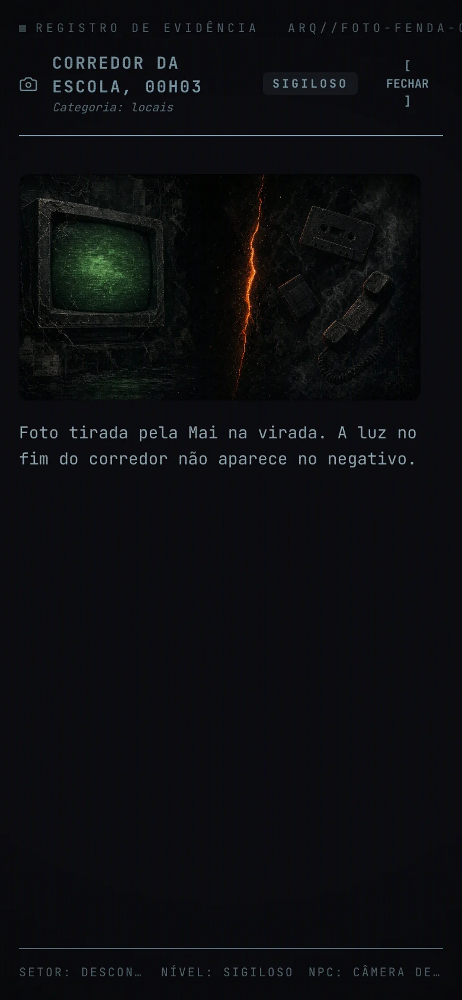
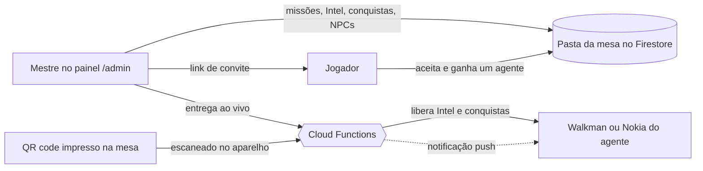
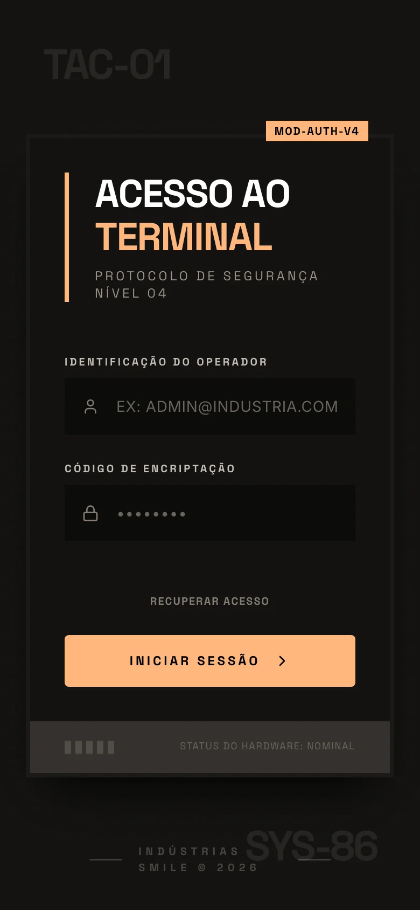
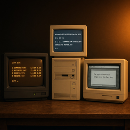
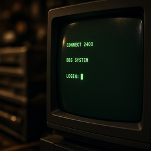
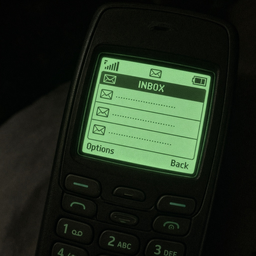

<p align="center">
  
</p>

<h1 align="center">LimboOS</h1>

<p align="center">
  Companion de campanha para RPG de mesa, com a Intel entregue em aparelhos de 1999.
</p>

<p align="center">
  <a href="#o-universo">Universo</a> ·
  <a href="#como-uma-sessão-funciona">Sessão</a> ·
  <a href="#os-aparelhos">Aparelhos</a> ·
  <a href="#sistemas-de-época">Sistemas de época</a> ·
  <a href="#painel-do-mestre">Painel do mestre</a> ·
  <a href="#rodar-localmente">Rodar localmente</a> ·
  <a href="#licença">Licença</a>
</p>

---

## O que é

O LimboOS é um app web que acompanha campanhas de RPG de mesa. Cada jogador entra como **agente** de uma agência fictícia e recebe pelo celular o material que o mestre libera ao longo da história: fitas de áudio, relatórios, fotos, gravações em VHS, mensagens de NPCs e conquistas. Todo esse material se chama **Intel**.

A Intel chega dentro de aparelhos que parecem ter saído de 1999. Na campanha das fitas o agente carrega um walkman; na de 2003, um Nokia com tela de LCD verde. Atrás deles ficam um PC com MH-DOS, um Windows 95, um Macintosh e um fórum BBS chamado Limbo, que o mestre abre quando a trama pede.

A sessão continua na mesa, com dados, fichas e conversa. O LimboOS cobre o equipamento que o personagem usa entre uma cena e outra, e às vezes no meio dela, enquanto o mestre controla a entrega por um painel web, ao vivo.

> 📌 Todas as telas deste README são capturas do app rodando contra os emuladores do Firebase, com a mesa de demonstração de [`scripts/readme-shots/`](scripts/readme-shots/). Agentes, fitas e documentos são dados de exemplo; a lore e as conversas de NPC vêm do material original das campanhas.

---

## O universo

<table>
<tr>
<td width="40%" valign="top">

</td>
<td valign="top">

No centro da ficção está o **Limbo**, o lugar para onde vão as memórias esquecidas: um intervalo no tempo em que o que foi apagado ainda ecoa.

A **fenda** é a rachadura que leva até lá. Na lore do LimboOS, o bug do milênio abriu essa fenda na virada de 1999 para 2000. O mundo de fora seguiu inteiro; o que se abriu foi uma porta para o lado de dentro das lembranças.

Swallow Rest, Ashfield Springs, a banda Polarized, vizinhanças silenciosas demais e sons que param de distorcer formam a atmosfera das campanhas originais. O app entrega o mistério em pedaços e deixa a explicação para a mesa: uma fita, um relatório datilografado, uma foto em que a luz do fim do corredor não aparece no negativo.

Outras mesas podem levar os agentes para megalópoles neon, estações orbitais, desertos fora do mapa ou simulações dos anos 80; o catálogo legado traz Neo-Sampa 2099, Estação Orbital Zero, The Retro Grid e Zona Morta: Arizona como exemplos. Cada mestre cria as próprias missões, com capa, sistema de RPG, local, ano, status (ativa, bloqueada ou arquivada) e o aparelho que o agente vai usar.

</td>
</tr>
</table>

---

## Como uma sessão funciona



1. **Convite.** O mestre monta a missão no painel e manda um link `/convite/…`, com validade e limite de usos.
2. **Entrada.** O jogador abre o link, entra com ID mestre e senha (ou Google e Apple) e recebe um agente na mesa, já no esquadrão certo.
3. **Agente e missão.** Na seleção de agente ele escolhe o personagem; na de campanhas, a missão da noite.
4. **Aparelho.** A missão define o aparelho: walkman para fitas, Nokia para a campanha de 2003.
5. **Intel.** O conteúdo chega por duas vias: o mestre entrega pelo painel, ou o jogador escaneia um QR code que o mestre imprimiu e deixou na mesa.
6. **Sistemas.** Com a trama avançando, o mestre libera o DOS, o Mac, o Limbo e o reparo de disco, e pode abrir o terminal na tela de todos os agentes de uma vez.

<table>
<tr>
<td align="center" width="25%"><br /><sub>Convite</sub></td>
<td align="center" width="25%"><br /><sub>Login</sub></td>
<td align="center" width="25%"><br /><sub>Seleção de agente</sub></td>
<td align="center" width="25%"><br /><sub>Campanhas ativas</sub></td>
</tr>
</table>

---

## Os aparelhos

### Walkman (Last Rewind, 1999–2000)

O walkman é o aparelho da campanha das fitas. A gaveta mostra a fita inserida, com lado e banda na etiqueta, e os carretéis giram enquanto ela toca. Abaixo fica a lista de provas do agente: fitas, disquetes e fotos, cada um com o ícone do formato. Na lateral estão o botão de perfil, a roda que troca o modo de exibição da lista e o volume deslizante; embaixo, rebobinar, play e o menu de Sistemas. A tecla que trava, a mola da tampa, a fita encaixando e o motor do rebobinar têm som mecânico próprio, sintetizado no navegador.

Disquetes e fotos abrem no leitor de evidência, com nível de sigilo, setor e o NPC que recuperou o material. Em **Last Rewind**, o walkman é a chave emocional da década: o agente ouve um áudio que alguém gravou para ele.

<table>
<tr>
<td align="center" width="33%"><br /><sub>Fita tocando</sub></td>
<td align="center" width="33%"><br /><sub>Relatório datilografado</sub></td>
<td align="center" width="33%"><br /><sub>Ficha do agente</sub></td>
</tr>
</table>

### Nokia (Last Rewind: Side B, 2003)

Na Side B o ano é 2003, a cidade parece reescrita e o aparelho é um Nokia de tela LCD verde, companheiro de uma contagem regressiva cuja única saída é voltar ao ponto zero. A tela inicial separa a Intel em áudio, vídeo, documentos e SMS. O correio de voz toca com barra de progresso; os vídeos aparecem como fitas VHS ou discos DVD; a aba SMS reúne as conversas com os NPCs de Swallow Rest (Mai, Bocão, Joe, Jaden e Nil), escritas em [`sms/`](sms/) e entregues pelo mestre ao esquadrão.

<table>
<tr>
<td align="center" width="50%"><br /><sub>Correio de voz</sub></td>
<td align="center" width="50%"><br /><sub>SMS de NPC</sub></td>
</tr>
</table>

---

## Intel

| Tipo | O que chega ao agente | Onde aparece |
|:-----|:----------------------|:-------------|
| **Áudio** | Fitas, recados de secretária eletrônica, correio de voz, ruídos que não deveriam estar ali | Walkman e Nokia |
| **Texto** | Relatórios, bilhetes, disquetes recuperados | Leitor de evidência |
| **Visual** | Fotos de locais, pistas, pessoas e itens | Leitor de evidência e arquivo visual da ficha |
| **Vídeo** | Gravações em VHS ou DVD, por upload ou link do YouTube | Nokia; o mestre também pode transmitir na tela do agente |
| **Meta** | Peças especiais da trama e easter eggs | Conquistas e marcadores de sistema |

Cada item tem um **nível de sigilo**, que aparece no leitor de evidência e no catálogo do mestre:

| Nível | Selo | Uso típico |
|:-----:|:-----|:-----------|
| 1 | RESTRITO | Briefings, fotos de locais, fitas introdutórias |
| 2 | CONFIDENCIAL | Dossiês de NPCs, mapas, diários de áudio |
| 3 | SIGILOSO | Provas de crimes, interceptações, disquetes corrompidos |
| 4 | TOP SECRET | Conquistas raras, easter eggs, revelações finais |

O progresso pertence ao **agente**, e a conta só agrupa os agentes: conta → agente → Intel e conquistas. Quem joga duas campanhas com dois personagens tem dois dossiês separados.

---

## Sistemas de época

Os mini-apps imitam sistemas reais da época e mantêm a aparência original, com fontes, cores e janelas de 1994 a 1999. O mestre liga cada um por missão (aba Mini-apps) e libera o acesso de hardware agente por agente.

<table>
<tr>
<td align="center" width="50%"><br /><sub>MH-DOS 6.22</sub></td>
<td align="center" width="50%"><br /><sub>Limbo Board</sub></td>
</tr>
<tr>
<td align="center" width="50%"><br /><sub>Reparo de disco</sub></td>
<td align="center" width="50%"><br /><sub>Windows 95</sub></td>
</tr>
</table>

- **MH-DOS 6.22.** O PC #07 da Haven Bytes, em Swallow Rest, aceita comandos como `DIR`, `HELP`, `VER`, `MEM` e `LOG`. Digitar o IP certo, que a campanha entrega aos poucos, conecta ao Limbo; `EXE` com a linha vazia dá boot no Windows 95.
- **Limbo Board.** O BBS LIMBO_01 guarda tópicos sobre o pós-bug, frequências, black vans e o ponto zero, em várias línguas. O mestre deixa o Limbo livre ou tomado, e o painel acompanha quantos tópicos cada agente leu.
- **Reparo de disco.** O Desmagnetizador recebe um disquete corrompido e mostra o conteúdo embaralhado. O reparo só roda depois que o mestre libera `DISKREPAIR.EXE` nos controles da sessão, e o arquivo recuperado vira Intel.
- **Windows 95 e Mac OS 7.1.** São desktops fantasmas: Meu Computador, Lixeira e DiskRepair Pro de um lado, o Macintosh da Byte Haven com tela de login do outro. O acesso ao Mac é liberado separado do DOS.

<table>
<tr>
<td width="30%" valign="top"></td>
<td valign="top">

### Terminal ARG

A rota `/terminal` fica fora do fluxo principal. É uma tela de acesso das Indústrias Smile, com protocolo de segurança nível 04, pensada para o jogador que fuça a URL além do que o mestre mostrou.

Se algo no LimboOS parece estranho, incompleto ou um pouco quebrado, às vezes é de propósito: a fenda também rachou a interface.

</td>
</tr>
</table>

---

## Conquistas

<table>
<tr>
<td width="34%" valign="top"></td>
<td valign="top">

O agente acumula medalhas: ouviu a fita inteira, escaneou três fitas em menos de cinco minutos, deu boot no DOS, consertou o disquete, apertou os parafusos do walkman, deixou o volume no zero.

O catálogo original tem 39 conquistas, divididas em progressão, exploração, lore, mecânica e honra, com classes comum, rara e lendária. Parte delas vem de regras automáticas (fitas escaneadas, tempo de escuta, sistemas abertos); outras o mestre entrega na mesa, no momento certo. Cada desbloqueio aparece como um registro de medalha no topo da tela, com o ícone e a classe.

A ficha do agente reúne as conquistas por campanha, as provas, o arquivo visual, a linha de contato, o idioma (PT ou EN) e a playlist do Spotify que o jogador conecta ao seu deck.

<p>
  
  
  
  
  
  
  
  
  
  
  
  
  
  
</p>

</td>
</tr>
</table>

---

## Painel do mestre

<p align="center">
  
</p>

O painel em `/admin` foi desenhado para a hora da sessão, quando o mestre precisa soltar a pista no segundo em que a mesa fica em silêncio. Ele se divide em cinco destinos, com atalhos de ⌘1 a ⌘5, busca global em ⌘K e o botão **Jogar como agente**, que abre o app do jogador com a conta do mestre.

- **Ao vivo.** O mestre escolhe o esquadrão e a missão da noite e vê quem está online. Dali entrega Intel, conquista, SMS, vídeo ou push para um agente ou para todos, abre o DOS e o Mac na tela dos jogadores, controla o Limbo e o reparo de disco e acompanha o log em tempo real.
- **Missões.** Cada missão mostra a prontidão (briefing, capa, Intel, conquistas, NPCs e esquadrões) e abre uma página com as abas Recursos, Dados, Vínculos, Inventário, Mini-apps e Equipe.
- **Conteúdo.** Reúne Intel e mídia (upload por arrastar e soltar, pastas e catálogo), conquistas, NPCs e diálogos de SMS, QR codes e links, com um filtro de missão único.
- **Mesa.** Organiza esquadrões, agentes e contas e o acesso de hardware (DOS e Mac) de cada agente.
- **Sistema.** Traz relatórios da operação e o log completo; a conta com papel de admin da plataforma também gerencia as contas de todos os mestres.

<table>
<tr>
<td align="center" width="50%"><br /><sub>Missões</sub></td>
<td align="center" width="50%"><br /><sub>Prontidão da missão</sub></td>
</tr>
<tr>
<td align="center" width="50%"><br /><sub>Catálogo de conquistas</sub></td>
<td align="center" width="50%"><br /><sub>Esquadrões</sub></td>
</tr>
</table>

### Mesas, convites e co-mestres

Cada mestre tem uma **pasta** própria com todo o conteúdo das mesas dele, e ninguém entra numa mesa sem convite. O dono convida jogadores (que ganham um agente e uma vaga no esquadrão) e co-mestres, que enxergam só as campanhas para as quais foram chamados. O jogador nunca lista a biblioteca do mestre: a mídia chega pelas Cloud Functions, e só depois de desbloqueada.

---

## App no celular

O mesmo código roda no navegador e nos apps de iOS e Android, empacotados com Capacitor. No app nativo o login com Google e Apple usa o sistema do aparelho, os links de convite abrem direto no app e o jogador recebe notificação push quando o mestre entrega Intel ou conquista, quando um NPC manda a primeira mensagem e quando um vídeo é transmitido. A abertura mostra a logo da Dark Room sobre o preto de fita magnética.

---

## Tom e direção visual

LimboOS é ARG com carinho de mesa de RPG. A interface do app é uma bancada escura de 1999: carvão quente, âmbar `#FF8C00` da fenda, fósforo verde de CRT, relevo de aparelho e nenhum contorno em volta de botões e blocos. Os títulos usam Space Grotesk, o texto usa Inter e os dados usam JetBrains Mono. O walkman, a tela LCD do Nokia e os sistemas de época mantêm as texturas e as linhas originais. Os textos são escritos em português do Brasil, com versão em inglês. As regras completas estão em [`DESIGN.md`](DESIGN.md) e o posicionamento do produto em [`PRODUCT.md`](PRODUCT.md).

O LimboOS imita sistemas operacionais sem ser um e depende da mesa para funcionar: sem um mestre liberando Intel no ritmo da história, os aparelhos ficam vazios. Por isso o app evita feed, ranking e pontuação genérica, e cada tela fala como equipamento da agência.

---

## Rodar localmente

| Camada | Tecnologia |
|:-------|:-----------|
| Interface | React 19, TypeScript, Tailwind CSS 4, Motion |
| Build | Vite 6 |
| Rotas | React Router 7 (`/`, `/admin/*`, `/terminal/*`, `/convite/:token`) |
| Backend | Firebase: Auth, Firestore, Storage, Cloud Functions, Hosting |
| Apps nativos | Capacitor 8 (iOS e Android) |

Pré-requisitos: Node 22, Java 21 ou mais novo e o [Firebase CLI](https://firebase.google.com/docs/cli). O backend (regras, Functions e hosting) fica no submódulo `backend/`.

```bash
git clone --recurse-submodules https://github.com/xXinous/LimboOS.git
cd LimboOS
npm install
cp .env.example .env   # preencha as variáveis VITE_FIREBASE_*
npm run dev
```

Para testar sem tocar no projeto real, suba os emuladores e aponte o app para eles. Com os emuladores, qualquer valor não vazio em `VITE_FIREBASE_API_KEY` funciona.

```bash
cd backend && firebase emulators:start --only auth,firestore,functions,storage --project demo-limboos
```

```bash
VITE_USE_EMULATORS=true VITE_FIREBASE_PROJECT_ID=demo-limboos npx vite --port 5190
```

O script [`scripts/readme-shots/seed-demo.cjs`](scripts/readme-shots/seed-demo.cjs) monta a mesa de demonstração usada nas capturas (a pasta "Mesa de Swallow Rest", cinco contas, dois esquadrões, fitas, documentos, fotos, um VHS e duas conversas de NPC); as contas e a senha de teste estão no cabeçalho dele. Para regenerar as telas e a capa deste README depois de mudar a interface:

```bash
node scripts/readme-shots/seed-demo.cjs
npm i --no-save playwright-core && node scripts/readme-shots/capture.mjs
```

Outros comandos úteis:

| Comando | O que faz |
|:--------|:----------|
| `npm run lint` | Checagem de tipos (`tsc --noEmit`) |
| `npm run build` | Build de produção em `backend/dist` |
| `npm run native:ios` / `npm run native:android` | Build, `cap sync` e abre o Xcode ou o Android Studio |
| `cd backend/rules-tests && npm test` | Testes das regras do Firestore e do Storage no emulador |
| `cd backend/rules-tests && npm run test:functions` | Testes das Cloud Functions no emulador |

O mapa do código, os conceitos de domínio e as convenções do projeto estão em [`AGENTS.md`](AGENTS.md).

---

## Licença

O **código-fonte** do LimboOS é distribuído sob a [PolyForm Noncommercial License 1.0.0](https://polyformproject.org/licenses/noncommercial/1.0.0). O texto completo está em [`LICENSE`](LICENSE).

- **Uso permitido.** Você pode usar, estudar, modificar e publicar forks apenas para fins não comerciais.
- **Atribuição.** Redistribuições precisam manter os avisos `Required Notice:` do `LICENSE` e citar o LimboOS como projeto original.
- **Uso comercial.** Produto, SaaS, white-label ou qualquer forma de monetização ficam proibidos por essa licença; para negociar outro tipo de uso, abra uma issue ou fale com [github.com/GoobinEXE](https://github.com/GoobinEXE).

### Código e universo

A licença do código não cobre o conteúdo narrativo. Um fork não comercial do código continua sem autorização para republicar o universo LimboOS, que tem **todos os direitos reservados** (ou termos próprios, quando indicados) sobre:

- personagens, NPCs e textos narrativos, incluindo a pasta `sms/`;
- a lore das campanhas, dossiês e Intel de conteúdo;
- artes, áudios, imagens e demais mídias;
- a marca e o nome **LimboOS**.

As dependências de terceiros (npm e afins) seguem as próprias licenças.

---

<p align="center">
  
</p>

<p align="center">
  <em>Bem-vindo à fenda. Rebobine com cuidado.</em>
</p>
