<p align="center">
  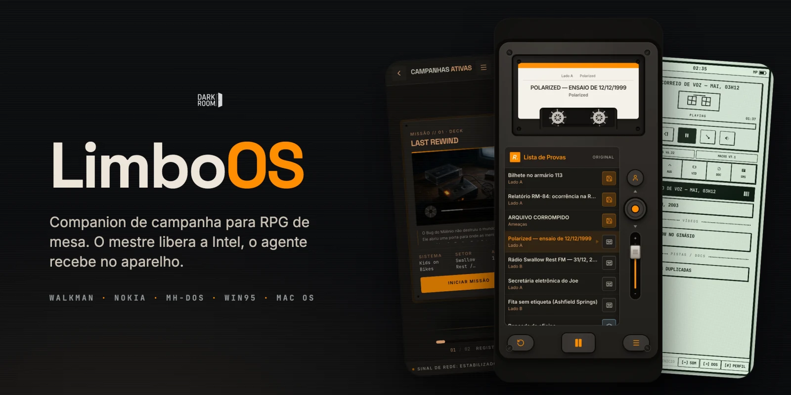
</p>

<h1 align="center">LimboOS</h1>

<p align="center">
  Plataforma para criar o companion app da sua campanha de RPG de mesa.<br />
  Você monta o conteúdo, os jogadores recebem tudo no celular, no aparelho que você escolher.
</p>

<p align="center">
  <a href="#o-que-é">O que é</a> ·
  <a href="#como-funciona">Como funciona</a> ·
  <a href="#aparelhos">Aparelhos</a> ·
  <a href="#tipos-de-conteúdo">Conteúdo</a> ·
  <a href="#mini-apps">Mini-apps</a> ·
  <a href="#painel-do-mestre">Painel do mestre</a> ·
  <a href="#rodar-localmente">Rodar localmente</a> ·
  <a href="#licença">Licença</a>
</p>

---

## O que é

O LimboOS é uma plataforma web e mobile para mestres de RPG que querem entregar material aos jogadores de forma imersiva. Em vez de imprimir handouts ou mandar arquivos soltos no grupo, o mestre cadastra áudios, textos, imagens, vídeos, conquistas e conversas com NPCs, e libera cada item no momento certo da sessão.

O jogador abre o app no celular e vê o material dentro de um aparelho que combina com a ambientação: walkman, celular com tela de LCD, terminais e desktops de época. O mestre controla a entrega por um painel web, ao vivo, sem interromper a mesa.

Cada mestre trabalha na própria pasta, com missões, jogadores e conteúdo isolados dos demais. A plataforma não impõe cenário, sistema de regras nem lore: o universo da campanha é o que você cadastrar.

> 📌 As telas deste README são capturas do app rodando contra os emuladores do Firebase, com a mesa de demonstração de [`scripts/readme-shots/`](scripts/readme-shots/). Agentes, fitas e documentos são dados de exemplo.

---

## Como funciona

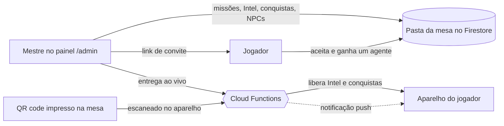

1. **Criação.** O mestre cria uma missão (campanha) no painel, com capa, sistema de RPG, local, ano e status, e cadastra o conteúdo.
2. **Convite.** Cada jogador recebe um link `/convite/…` com validade e limite de usos. Co-mestres entram da mesma forma e enxergam só as missões para as quais foram chamados.
3. **Personagem.** O jogador entra com e-mail e senha (ou Google e Apple) e escolhe o personagem da noite. O progresso pertence ao personagem, e a conta só agrupa os personagens de cada pessoa.
4. **Aparelho.** A missão define o aparelho em que o conteúdo aparece.
5. **Entrega.** O conteúdo chega por duas vias: o mestre libera pelo painel, ou o jogador escaneia um QR code que o mestre imprimiu e deixou na mesa.
6. **Mini-apps.** Ao longo da história, o mestre libera sistemas extras (terminal, desktops, fórum) por missão ou por jogador.

<table>
<tr>
<td align="center" width="25%">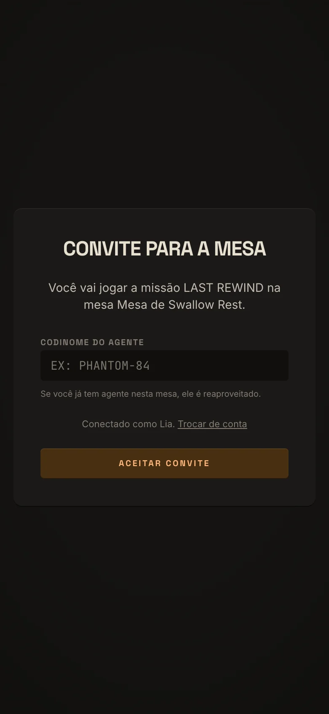<br /><sub>Convite</sub></td>
<td align="center" width="25%">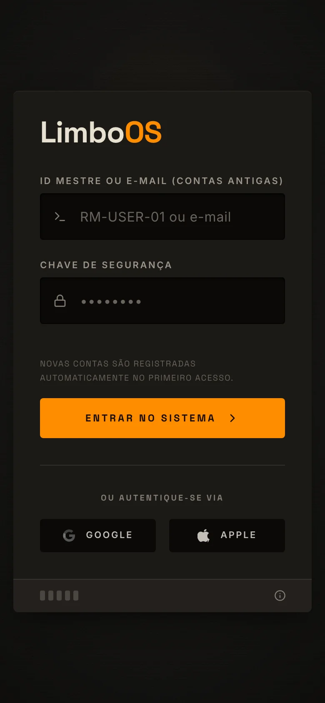<br /><sub>Login</sub></td>
<td align="center" width="25%">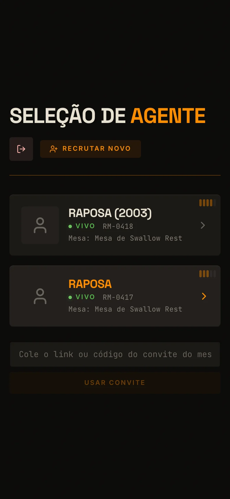<br /><sub>Seleção de personagem</sub></td>
<td align="center" width="25%">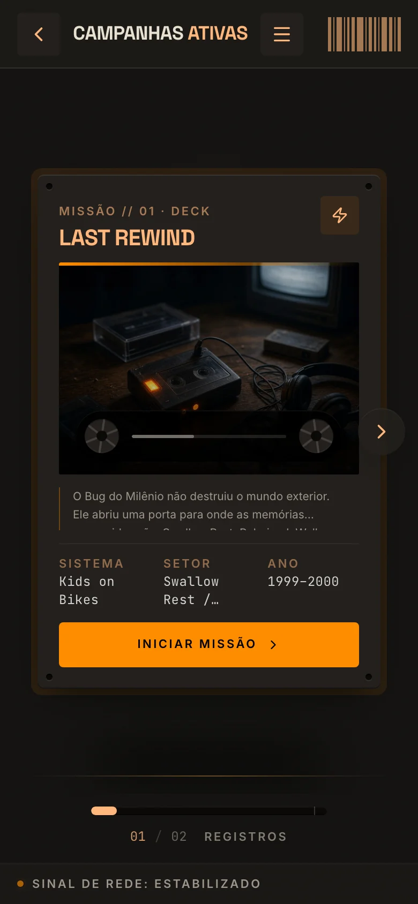<br /><sub>Campanhas ativas</sub></td>
</tr>
</table>

---

## Aparelhos

O aparelho é a moldura em que o jogador consome o conteúdo, e a missão escolhe qual usar.

**Walkman.** A gaveta mostra a fita inserida, com carretéis que giram durante a reprodução. Abaixo fica a lista de itens do personagem (fitas, disquetes e fotos), com opções de exibição, volume e menu de sistemas. A tecla que trava, a tampa, o encaixe da fita e o rebobinar têm som mecânico próprio, sintetizado no navegador. Disquetes e fotos abrem no leitor de evidência, com nível de sigilo e origem do material.

<table>
<tr>
<td align="center" width="33%">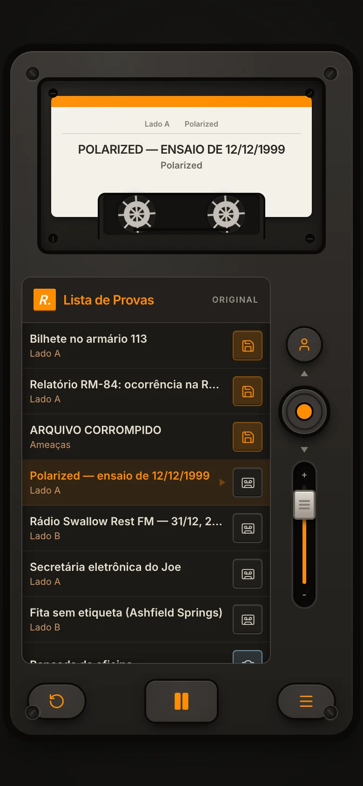<br /><sub>Fita tocando</sub></td>
<td align="center" width="33%">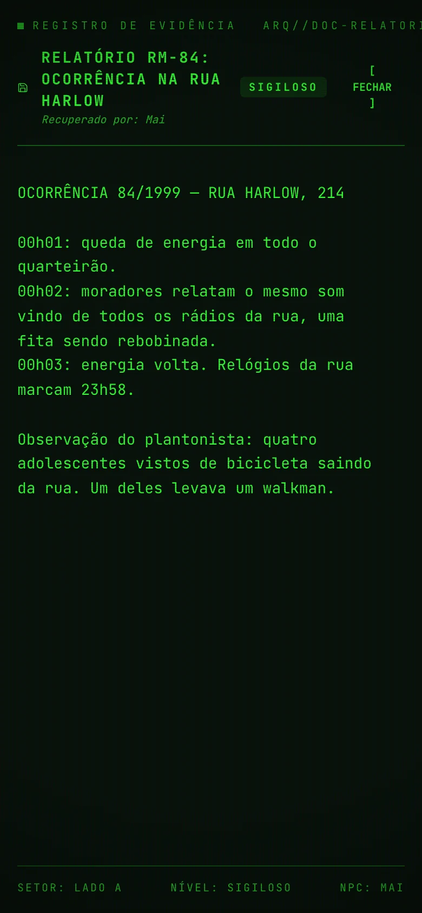<br /><sub>Documento no leitor de evidência</sub></td>
<td align="center" width="33%">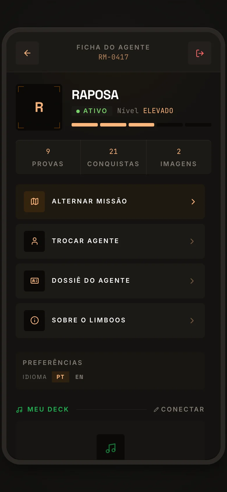<br /><sub>Ficha do personagem</sub></td>
</tr>
</table>

**Celular com tela de LCD.** A tela inicial separa o conteúdo em áudio, vídeo, documentos e SMS. O correio de voz toca com barra de progresso, os vídeos aparecem como fitas VHS ou discos DVD, e a aba de SMS reúne as conversas com os NPCs que o mestre escreveu e entregou ao grupo.

<table>
<tr>
<td align="center" width="50%">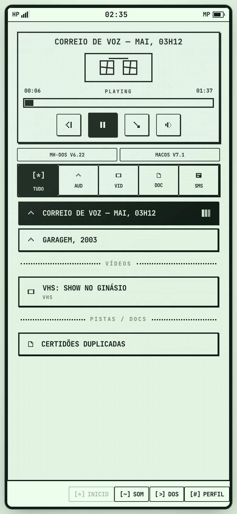<br /><sub>Correio de voz</sub></td>
<td align="center" width="50%">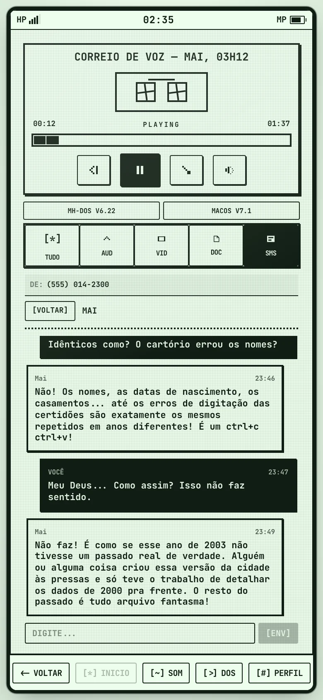<br /><sub>SMS de NPC</sub></td>
</tr>
</table>

---

## Tipos de conteúdo

Todo material entregue ao jogador se chama **Intel**. Cada item tem tipo, nível de sigilo e escopo de missão.

| Tipo | O que o jogador recebe | Onde aparece |
|:-----|:-----------------------|:-------------|
| **Áudio** | Fitas, gravações, recados, correio de voz | Walkman e celular |
| **Texto** | Relatórios, bilhetes, documentos | Leitor de evidência |
| **Visual** | Fotos de locais, pistas, pessoas e objetos | Leitor de evidência e arquivo visual da ficha |
| **Vídeo** | Gravações em VHS ou DVD, por upload ou link do YouTube | Celular; o mestre também pode transmitir na tela do jogador |
| **Meta** | Peças especiais da trama e marcadores de sistema | Conquistas e mini-apps |

O **nível de sigilo** vai de 1 (Restrito) a 4 (Top Secret), aparece no leitor de evidência e no catálogo do mestre, e serve para dar peso narrativo a cada item.

**Conquistas** são medalhas que o mestre define e entrega, ou que disparam por regras automáticas (itens ouvidos, tempo de escuta, sistemas abertos). Cada uma tem ícone, classe (comum, rara ou lendária) e aparece como registro no topo da tela do jogador.

**NPCs e SMS** permitem escrever diálogos ramificados que o mestre libera ao grupo, com notificação push na primeira mensagem.

**QR codes e links** deixam o mestre imprimir códigos que liberam um item específico quando o jogador escaneia, útil para pistas físicas escondidas na mesa ou no ambiente.

<table>
<tr>
<td width="34%" valign="top">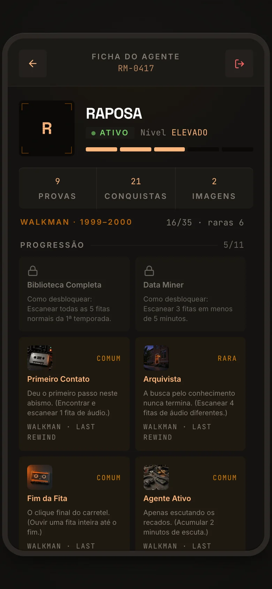</td>
<td valign="top">

A ficha do personagem reúne as conquistas por campanha, as provas, o arquivo visual, a linha de contato, o idioma (português ou inglês) e a playlist do Spotify que o jogador conecta ao aparelho.

</td>
</tr>
</table>

---

## Mini-apps

Mini-apps são experiências interativas que o mestre liga por missão e libera por personagem. Eles imitam sistemas de época, com fontes, cores e janelas de 1994 a 1999.

<table>
<tr>
<td align="center" width="50%">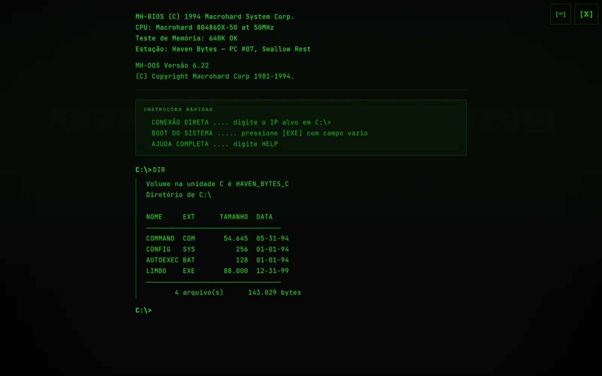<br /><sub>Terminal DOS</sub></td>
<td align="center" width="50%">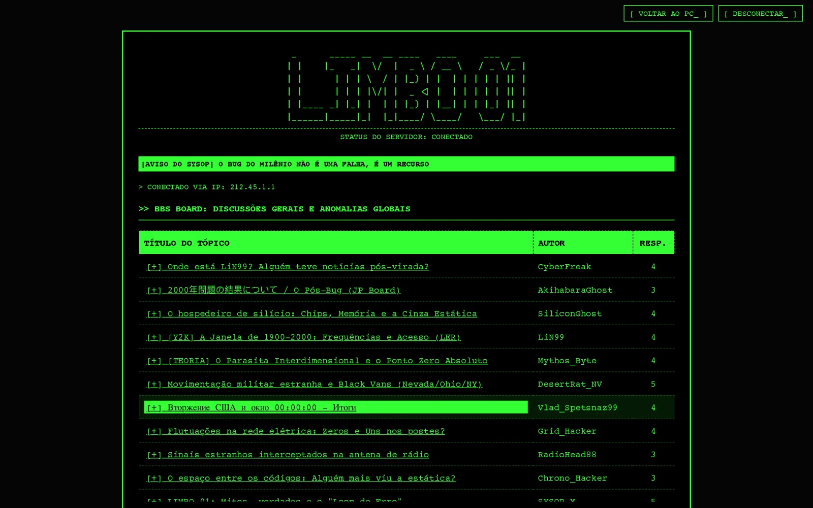<br /><sub>Fórum BBS</sub></td>
</tr>
<tr>
<td align="center" width="50%">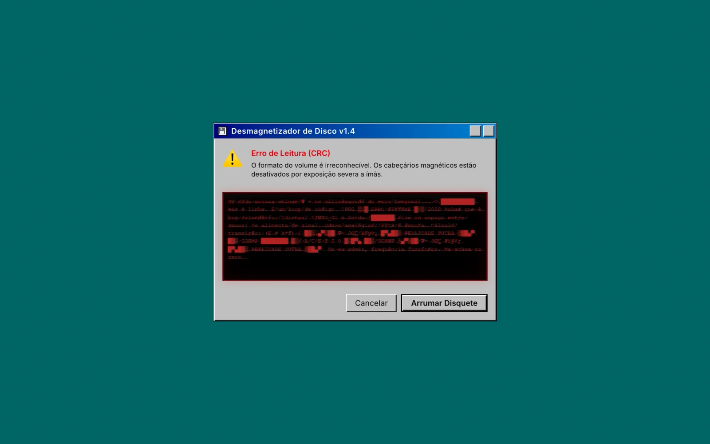<br /><sub>Reparo de disco</sub></td>
<td align="center" width="50%">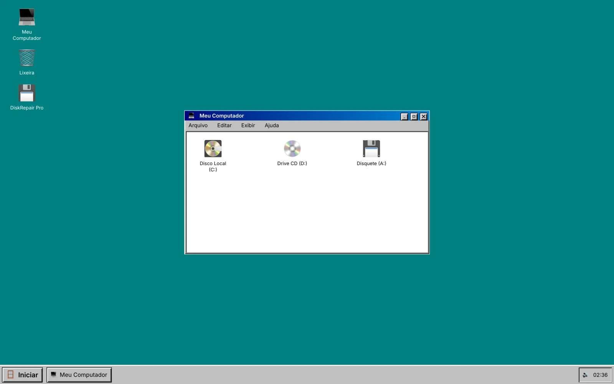<br /><sub>Desktop Windows 95</sub></td>
</tr>
</table>

- **Terminal DOS.** Aceita comandos como `DIR`, `HELP`, `VER`, `MEM` e `LOG`. O mestre define o IP ou a senha que conecta a outros sistemas da trama.
- **Fórum BBS.** Um quadro de mensagens com tópicos que o mestre escreve. O painel mostra quantos tópicos cada jogador leu, e o mestre pode deixar o fórum livre ou tomado.
- **Reparo de disco.** Recebe um disquete corrompido e mostra o conteúdo embaralhado. O reparo só roda depois que o mestre libera o programa nos controles da sessão, e o arquivo recuperado vira Intel.
- **Windows 95 e Mac OS 7.1.** Desktops navegáveis, com liberação de acesso separada por jogador.
- **Terminal ARG.** A rota `/terminal` fica fora do fluxo principal e serve de tela de acesso para o jogador que explora a URL além do que o mestre mostrou.

---

## Painel do mestre

<p align="center">
  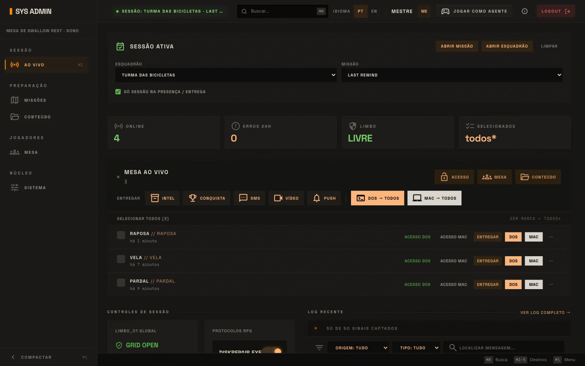
</p>

O painel em `/admin` foi desenhado para a hora da sessão, quando o mestre precisa soltar a pista no segundo em que a mesa fica em silêncio. Ele se divide em cinco destinos, com atalhos de ⌘1 a ⌘5, busca global em ⌘K e o botão **Jogar como agente**, que abre o app do jogador com a conta do mestre.

- **Ao vivo.** Escolha do esquadrão e da missão da noite, com a lista de quem está online. Dali o mestre entrega Intel, conquista, SMS, vídeo ou push para um jogador ou para todos, libera mini-apps na tela do grupo e acompanha o log em tempo real.
- **Missões.** Cada missão mostra a prontidão (briefing, capa, Intel, conquistas, NPCs e esquadrões) e abre uma página com as abas Recursos, Dados, Vínculos, Inventário, Mini-apps e Equipe.
- **Conteúdo.** Intel e mídia (upload por arrastar e soltar, pastas e catálogo), conquistas, NPCs e diálogos de SMS, QR codes e links, com um filtro de missão único.
- **Mesa.** Esquadrões, personagens, contas e acesso de hardware de cada jogador.
- **Sistema.** Relatórios da operação e log completo. A conta com papel de admin da plataforma também gerencia as contas de todos os mestres.

<table>
<tr>
<td align="center" width="50%">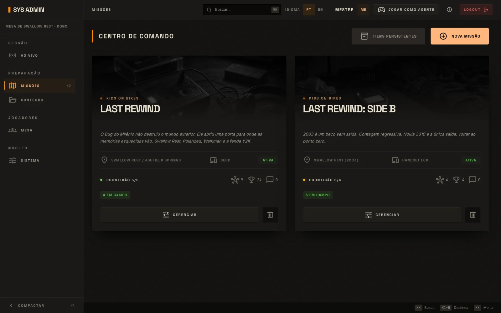<br /><sub>Missões</sub></td>
<td align="center" width="50%">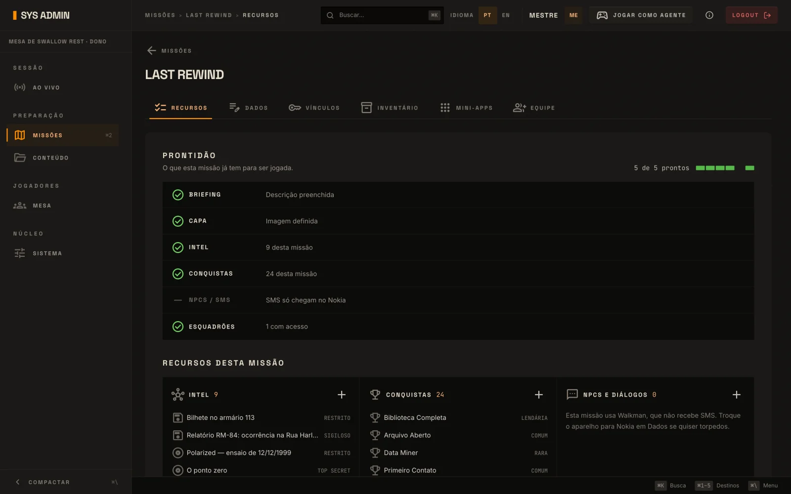<br /><sub>Prontidão da missão</sub></td>
</tr>
<tr>
<td align="center" width="50%">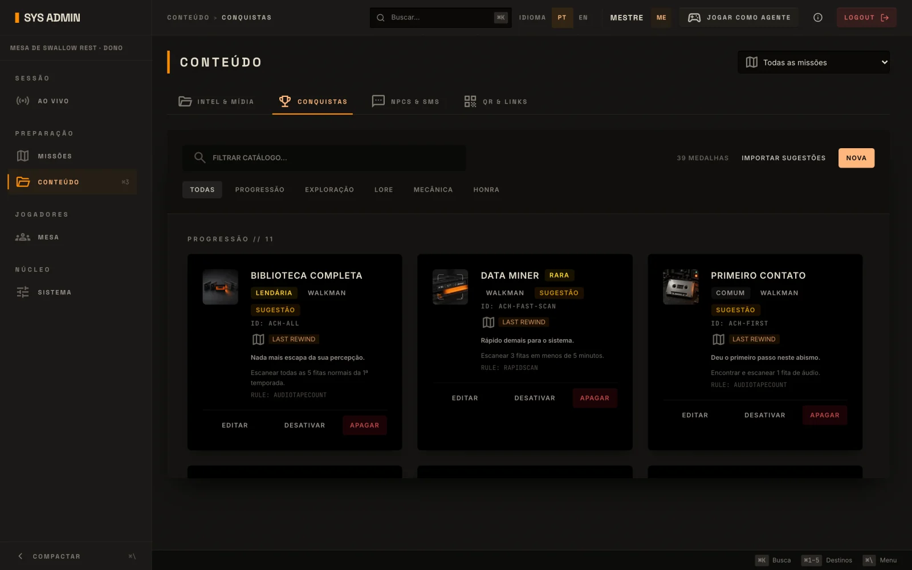<br /><sub>Catálogo de conquistas</sub></td>
<td align="center" width="50%">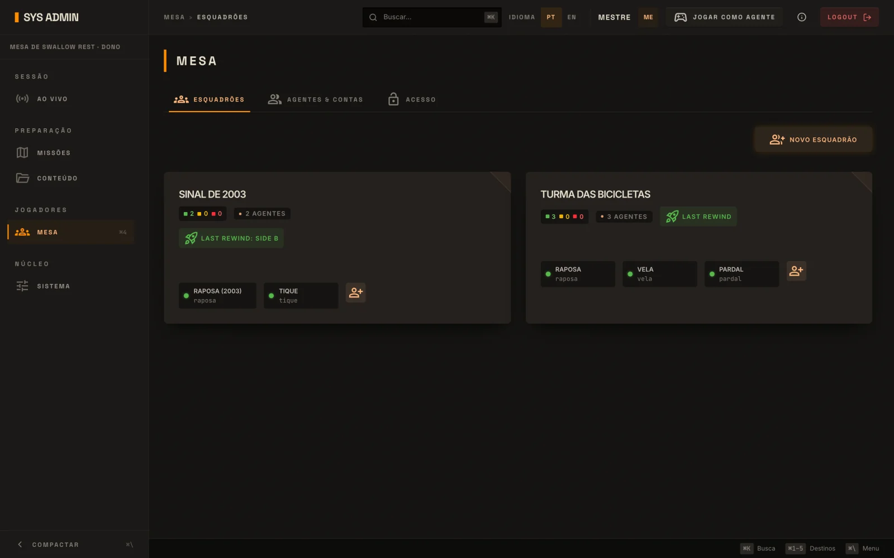<br /><sub>Esquadrões</sub></td>
</tr>
</table>

### Pastas, convites e co-mestres

Cada mestre tem uma **pasta** própria com todo o conteúdo das mesas dele, e ninguém entra numa mesa sem convite. O dono convida jogadores (que ganham um personagem e uma vaga no esquadrão) e co-mestres, que enxergam só as missões liberadas para eles. O jogador nunca lista a biblioteca do mestre: a mídia chega pelas Cloud Functions, e só depois de desbloqueada.

---

## App no celular

O mesmo código roda no navegador e nos apps de iOS e Android, empacotados com Capacitor. No app nativo, o login com Google e Apple usa o sistema do aparelho, os links de convite abrem direto no app e o jogador recebe notificação push quando o mestre entrega Intel ou conquista, quando um NPC manda a primeira mensagem e quando um vídeo é transmitido.

---

## Rodar localmente

| Camada | Tecnologia |
|:-------|:-----------|
| Interface | React 19, TypeScript, Tailwind CSS 4, Motion |
| Build | Vite 6 |
| Rotas | React Router 7 (`/`, `/admin/*`, `/terminal/*`, `/convite/:token`) |
| Backend | Firebase: Auth, Firestore, Storage, Cloud Functions, Hosting |
| Apps nativos | Capacitor 8 (iOS e Android) |

Pré-requisitos: Node 22, Java 21 ou mais novo e o [Firebase CLI](https://firebase.google.com/docs/cli). O backend (regras, Functions e hosting) fica no submódulo `backend/`.

```bash
git clone --recurse-submodules https://github.com/GoobinEXE/LimboOS.git
cd LimboOS
npm install
cp .env.example .env   # preencha as variáveis VITE_FIREBASE_*
npm run dev
```

Para testar sem tocar no projeto real, suba os emuladores e aponte o app para eles. Com os emuladores, qualquer valor não vazio em `VITE_FIREBASE_API_KEY` funciona.

```bash
cd backend && firebase emulators:start --only auth,firestore,functions,storage --project demo-limboos
```

```bash
VITE_USE_EMULATORS=true VITE_FIREBASE_PROJECT_ID=demo-limboos npx vite --port 5190
```

O script [`scripts/readme-shots/seed-demo.cjs`](scripts/readme-shots/seed-demo.cjs) monta a mesa de demonstração usada nas capturas: pasta, contas, esquadrões, fitas, documentos, fotos, um VHS e conversas de NPC. As contas e a senha de teste estão no cabeçalho dele. Para regenerar as telas e a capa deste README depois de mudar a interface:

```bash
node scripts/readme-shots/seed-demo.cjs
npm i --no-save playwright-core && node scripts/readme-shots/capture.mjs
```

Outros comandos úteis:

| Comando | O que faz |
|:--------|:----------|
| `npm run lint` | Checagem de tipos (`tsc --noEmit`) |
| `npm run build` | Build de produção em `backend/dist` |
| `npm run native:ios` / `npm run native:android` | Build, `cap sync` e abre o Xcode ou o Android Studio |
| `cd backend/rules-tests && npm test` | Testes das regras do Firestore e do Storage no emulador |
| `cd backend/rules-tests && npm run test:functions` | Testes das Cloud Functions no emulador |

O mapa do código, os conceitos de domínio e as convenções do projeto estão em [`AGENTS.md`](AGENTS.md). A direção visual está em [`DESIGN.md`](DESIGN.md) e o posicionamento do produto em [`PRODUCT.md`](PRODUCT.md).

---

## Licença

O **código-fonte** do LimboOS é distribuído sob a [PolyForm Noncommercial License 1.0.0](https://polyformproject.org/licenses/noncommercial/1.0.0). O texto completo está em [`LICENSE`](LICENSE).

- **Uso permitido.** Estudar, modificar e publicar forks para fins não comerciais.
- **Atribuição.** Redistribuições mantêm os avisos `Required Notice:` do `LICENSE` e citam o LimboOS como projeto original.
- **Uso comercial.** Produto, SaaS, white-label ou qualquer forma de monetização exigem autorização. Para negociar, abra uma issue ou fale com [github.com/GoobinEXE](https://github.com/GoobinEXE).

A licença do código não cobre a marca **LimboOS**, nem artes, áudios e demais mídias distribuídas com o repositório, que têm todos os direitos reservados. O conteúdo que cada mestre cadastra na plataforma pertence a ele. As dependências de terceiros seguem as próprias licenças.

---

<p align="center">
  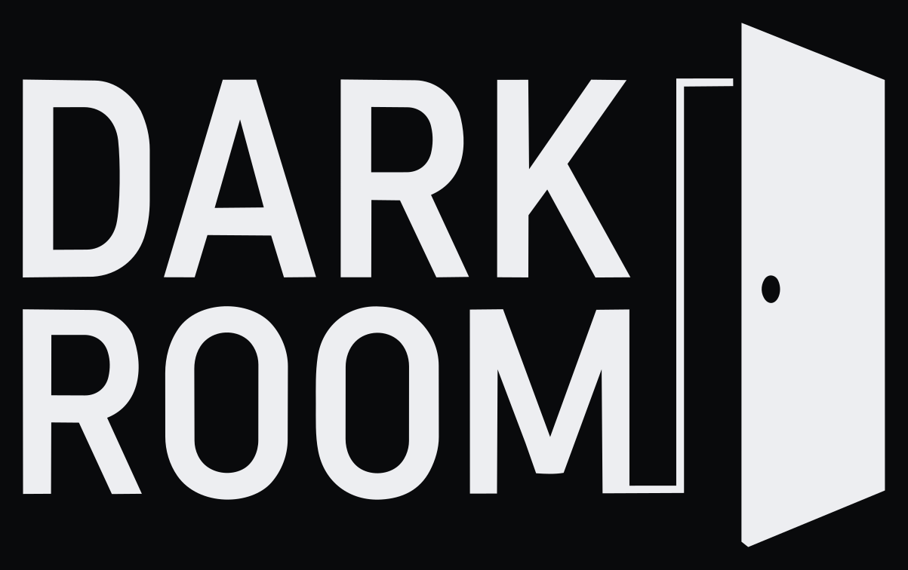
</p>
