<p align="center">
  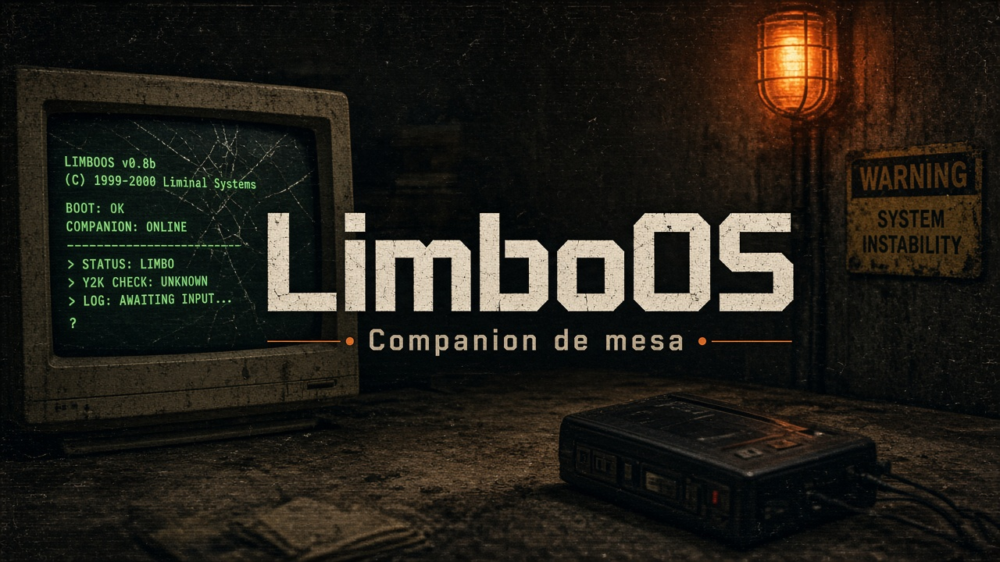
</p>

<h1 align="center">LimboOS</h1>

<p align="center">
  <strong>Um companion de campanha de RPG de mesa.</strong><br />
  Não é um sistema operacional de verdade.<br />
  É uma porta disfarçada de máquina.
</p>

<p align="center">
  
  &nbsp;
  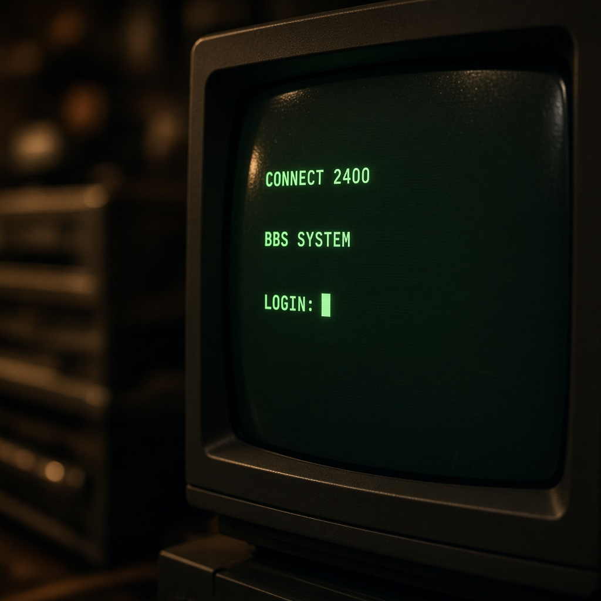
  &nbsp;
  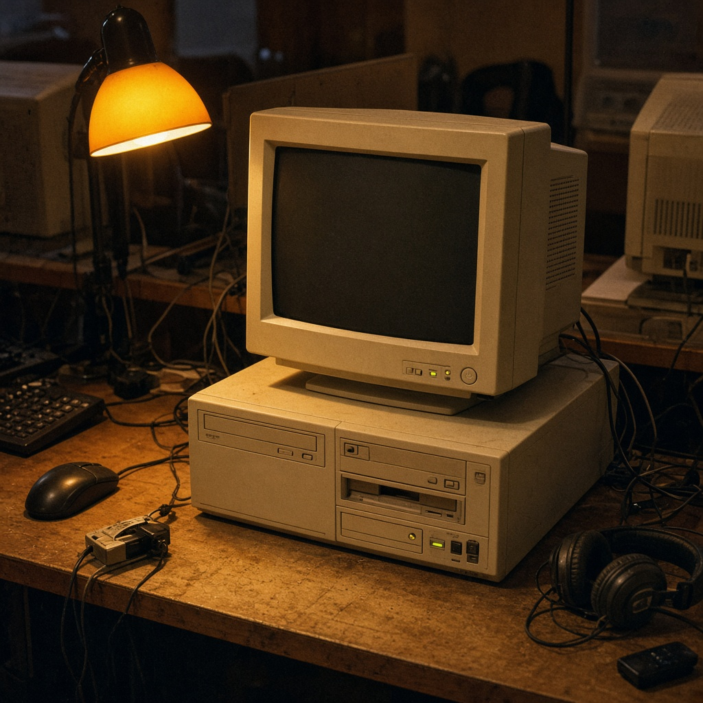
  &nbsp;
  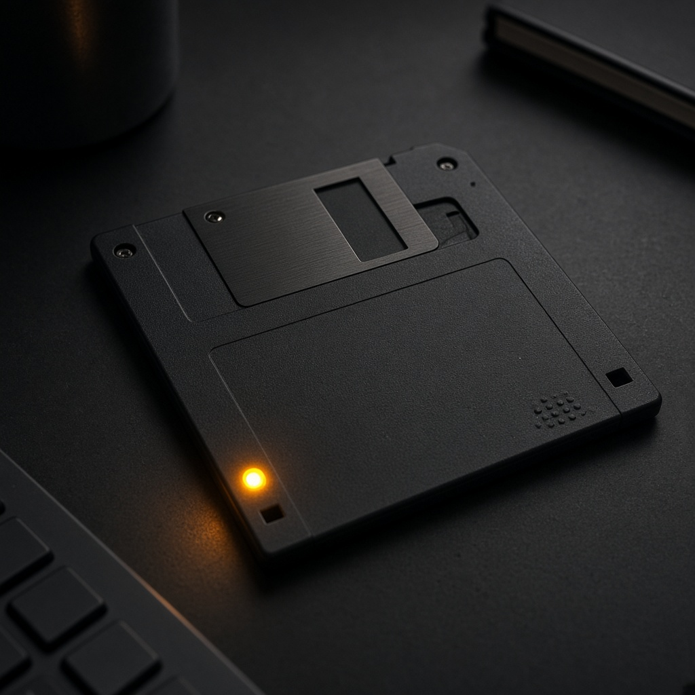
  &nbsp;
  
</p>

<p align="center">
  <em>Fitas · Mensagens · Dossiês · Conquistas · Portas que não deveriam abrir</em>
</p>

---

## O que é isto?

LimboOS é o aparelho oficial dos **agentes** — os personagens dos jogadores. Por ele chegam fitas, mensagens, fotos, dossiês, conquistas e pedaços de mundo que o mestre decide liberar na hora certa.

É um companion de mesa: a sessão continua no olhar, nos dados e na conversa. O LimboOS é o que o personagem *usa* entre uma cena e outra — e, às vezes, no meio dela.

A estética é deliberadamente anacrônica. Walkman. Nokia. BIOS. Windows 95. Mac clássico. Tudo parece ter vazado de outra década. Nada aqui tenta parecer “moderno”. O charme está no ruído, no pixel, no display verde, na fita que enrola e no celular que ainda tem teclas.

---

## O universo por trás da tela

<p align="center">
  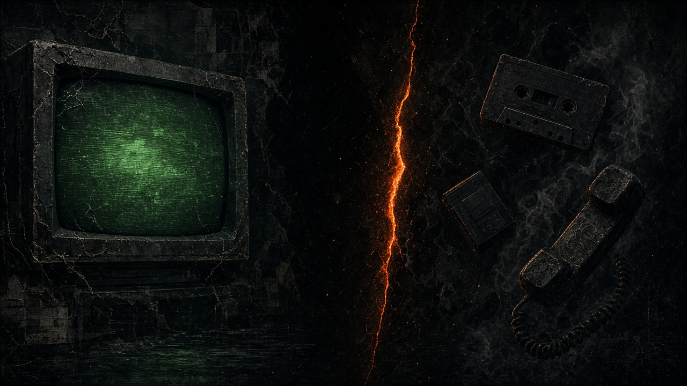
</p>

No centro da experiência está o **Limbo**: o lugar para onde vão as memórias esquecidas. Não é um inferno clássico nem um paraíso. É um intervalo — uma dobra no tempo onde o que foi apagado ainda ecoa.

A **fenda** é a rachadura. Em algumas campanhas, ela se abre por volta da virada do milênio. O Bug do Ano 2000, na lore do LimboOS, não destruiu o mundo de fora: abriu uma porta para o lado de dentro das lembranças.

Swallow Rest, Polarized, Ashfield Springs, anos 90 e 2000, loops que se fecham, vizinhanças silenciosas demais, sons que param de distorcer — tudo isso alimenta a atmosfera. O LimboOS não “explica” o mistério. Ele *entrega* o mistério na mão do jogador, em pedaços.

Outras campanhas levam os agentes para megalópoles neon, estações orbitais, desertos fora do mapa ou simulações nostálgicas. O aparelho acompanha: muda a pele, muda o tom, mantém a sensação de que você está operando algo que não deveria existir.

---

## Para quem é

<table>
<tr>
<td width="50%" valign="top">

### 🎧 Jogadores (agentes)

Você entra, escolhe o **personagem** e a **campanha**. A partir daí, o aparelho deixa de ser genérico: vira o walkman da sua missão, o Nokia da contagem regressiva, o terminal que alguém deixou ligado demais.

O que você encontra ali não é “conteúdo de app”. É **Intel** — inteligência de campo. Áudio. Texto. Imagem. Segredos com nível de sigilo. Coisas restritas. Coisas top secret. Coisas que o mestre solta quando a mesa pede silêncio e atenção.

Conforme a história avança, portas se abrem: consertar um disco, bisbilhotar um BBS, abrir um desktop antigo, ler SMS de NPCs, vasculhar o Limbo.

</td>
<td width="50%" valign="top">

### 🛰️ Mestre (operador)

Do outro lado existe o painel de comando. De lá o mestre vê a mesa viva: quem está online, quem precisa de uma fita agora, quem mereceu uma conquista, qual esquadrão recebe a próxima transmissão.

É possível montar campanhas, organizar missões, distribuir intel, enviar mensagens, acompanhar progresso e manter o ritmo da sessão sem quebrar a imersão dos jogadores.

O mestre não “administra um site”: ele opera o sistema que os agentes acreditam ser real.

</td>
</tr>
</table>

---

## A jornada do agente

```text
  ENTRAR
    ↓
  ASSUMIR O PERSONAGEM
    ↓
  ESCOLHER A CAMPANHA
    ↓
  PEGAR O DISPOSITIVO
    ↓
  CONSUMIR INTEL
    ↓
  ABRIR O QUE ESTAVA FECHADO
```

1. **Entrar** — a porta de acesso, no tom do universo.  
2. **Assumir o personagem** — você não joga “como usuário”; joga como agente.  
3. **Escolher a campanha** — o teatro da noite (ou da temporada).  
4. **Pegar o dispositivo** — walkman, Nokia ou o que a missão exigir.  
5. **Consumir Intel** — ouvir, ler, olhar, colecionar, desbloquear.  
6. **Abrir o que estava fechado** — BIOS, Limbo, terminais, desktops fantasma, conversas, consertos.

---

## Os aparelhos

<table>
<tr>
<td width="50%" align="center" valign="top">

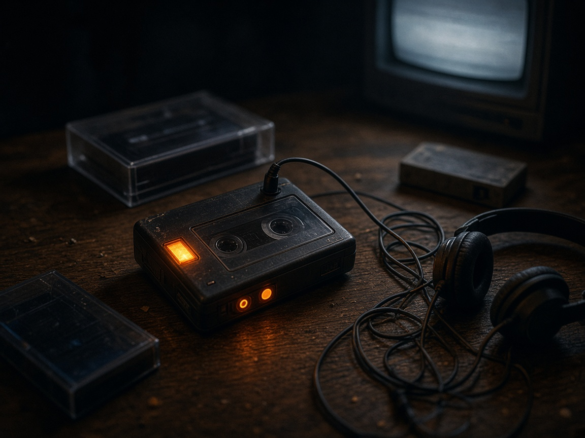

### Walkman

O coração das campanhas de fita e memória.  
Você carrega cassetes narrativos, troca modos de display, rebobina, pausa — e sente o peso de um áudio que alguém *gravou para você*.

Em **Last Rewind**, o walkman não é acessório: é a chave emocional da década.

</td>
<td width="50%" align="center" valign="top">

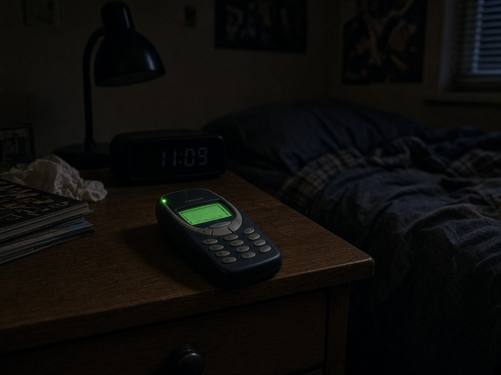

### Nokia

O celular que sobreviveu a tudo.  
Teclado físico, tela pequena, urgência.

Em **Last Rewind: Side B**, o ano é 2003 e o Nokia vira companheiro de contagem regressiva — SMS, alertas, a sensação de que a única saída é voltar ao ponto zero.

</td>
</tr>
</table>

<p align="center"><em>Cada campanha pode pedir um aparelho diferente. O LimboOS muda a pele sem perder a alma.</em></p>

---

## Intel — o que você coleta

| Tipo | O que chega na mão do agente |
|:-----|:-----------------------------|
| **Áudio** | Fitas, gravações, vozes, ruídos que não deveriam estar ali |
| **Texto** | Relatórios, recados, fragmentos, diálogos |
| **Visual** | Fotos, imagens, evidências |
| **Meta** | Peças especiais da trama — e, no horizonte, vídeo e mapas vivos |

Cada item carrega atmosfera e, muitas vezes, **nível de sigilo**: do restrito ao top secret.

Desbloquear Intel não é só “ganhar um arquivo”. É avançar no dossiê do agente — e, às vezes, no que o personagem ainda não está pronto para saber.

---

## Mini-experiências

Além do aparelho principal, o LimboOS esconde salas dentro de salas:

| | Experiência | Sensação |
|:---:|:------------|:---------|
| 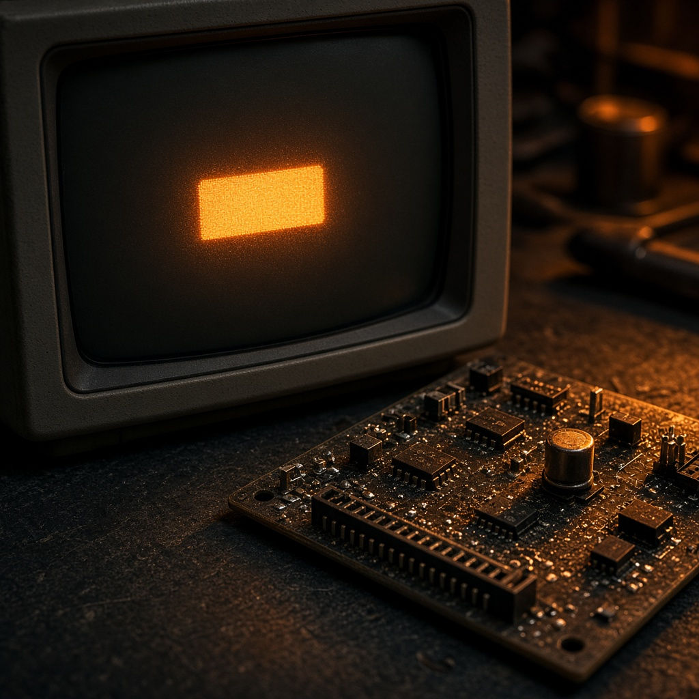 | **BIOS / Terminal** | Você está “por baixo” do sistema, digitando no escuro. |
|  | **Limbo Board / BBS** | Um quadro de mensagens secreto — ecos de quem passou por aqui. |
|  | **Reparo de disco** | Algo está corrompido. Consertar é narrativa, não só puzzle. |
|  | **Windows 95 / Mac OS** | Desktops fantasmas — o passado digital como cenário. |
| 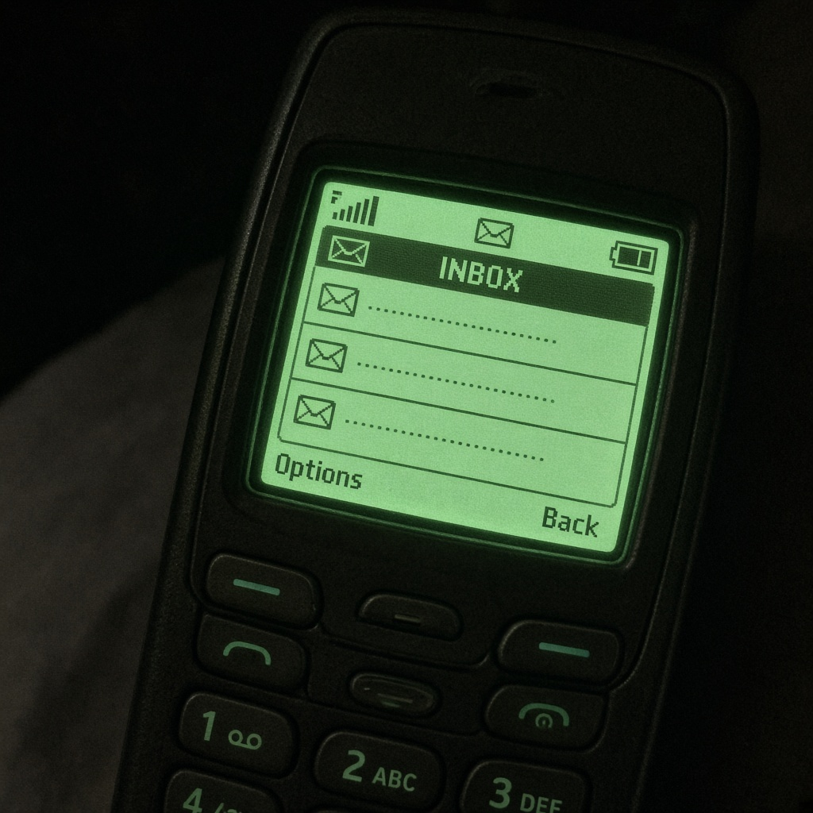 | **SMS de NPCs** | Joe, Mai, Nil, Bocão, Jaden… gente da cidade falando como gente. |
|  | **Terminal ARG** | Um canto lateral da ficção, para quem fuça demais. |

Nada disso existe para “mostrar recurso”. Existe para prolongar a mentira boa: *isto é o equipamento do seu agente*.

---

## Campanhas — o mapa possível

O LimboOS foi feito para carregar várias mesas. Algumas já habitam o universo:

<table>
<tr>
<td width="33%" align="center" valign="top">
<br />
<strong>Last Rewind</strong><br />
<sub>Swallow Rest · 1999–2000<br />Walkman · A fenda Y2K</sub>
</td>
<td width="33%" align="center" valign="top">
<br />
<strong>Last Rewind: Side B</strong><br />
<sub>Swallow Rest · 2003<br />Nokia · Contagem regressiva</sub>
</td>
<td width="33%" align="center" valign="top">
<br />
<strong>Neo-Sampa 2099</strong><br />
<sub>Setor 011 · São Paulo<br />Neon · Resistência</sub>
</td>
</tr>
<tr>
<td width="33%" align="center" valign="top">
<br />
<strong>Estação Orbital Zero</strong><br />
<sub>Órbita baixa · 2105<br />Elite · Segredos</sub>
</td>
<td width="33%" align="center" valign="top">
<br />
<strong>The Retro Grid</strong><br />
<sub>Cyber-espaço · 1984<br />Simulação · Vírus</sub>
</td>
<td width="33%" align="center" valign="top">
<br />
<strong>Zona Morta: Arizona</strong><br />
<sub>Deserto · 2097<br />Bloqueada — por enquanto</sub>
</td>
</tr>
</table>

Campanhas podem estar ativas, arquivadas ou bloqueadas — como portas de um corredor que o mestre abre quando a mesa está pronta.

---

## Conquistas e progresso

O agente acumula marcas: ouviu a fita certa, leu demais no BBS, consertou o que estava no zero, alternou o walkman até a obsessão.

Algumas conquistas são mecânicas (você fez a coisa). Outras são lore (você entrou no lugar certo da história). Algumas o mestre entrega na mesa, no olhar, no momento.

<p align="center">
  
  
  
  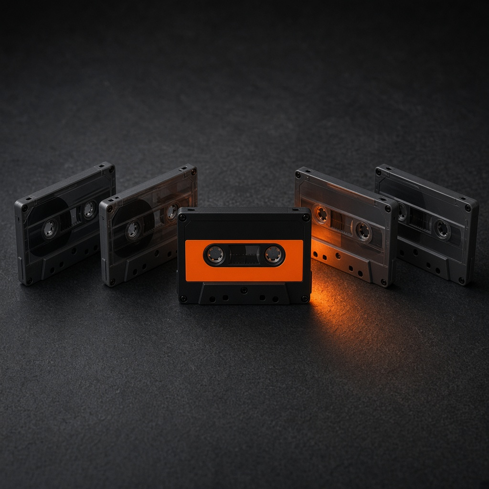
  
  
  
  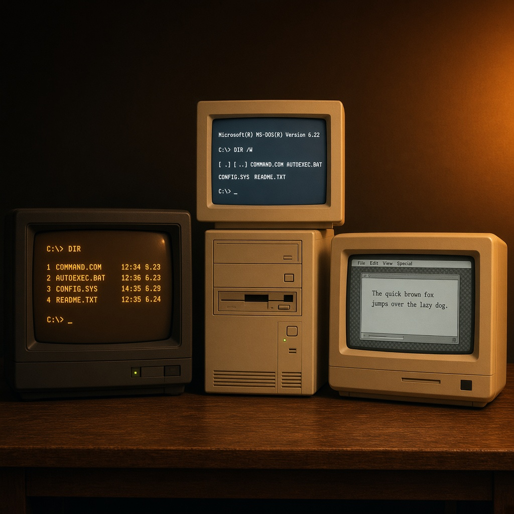
  
  
  
  
  
  
  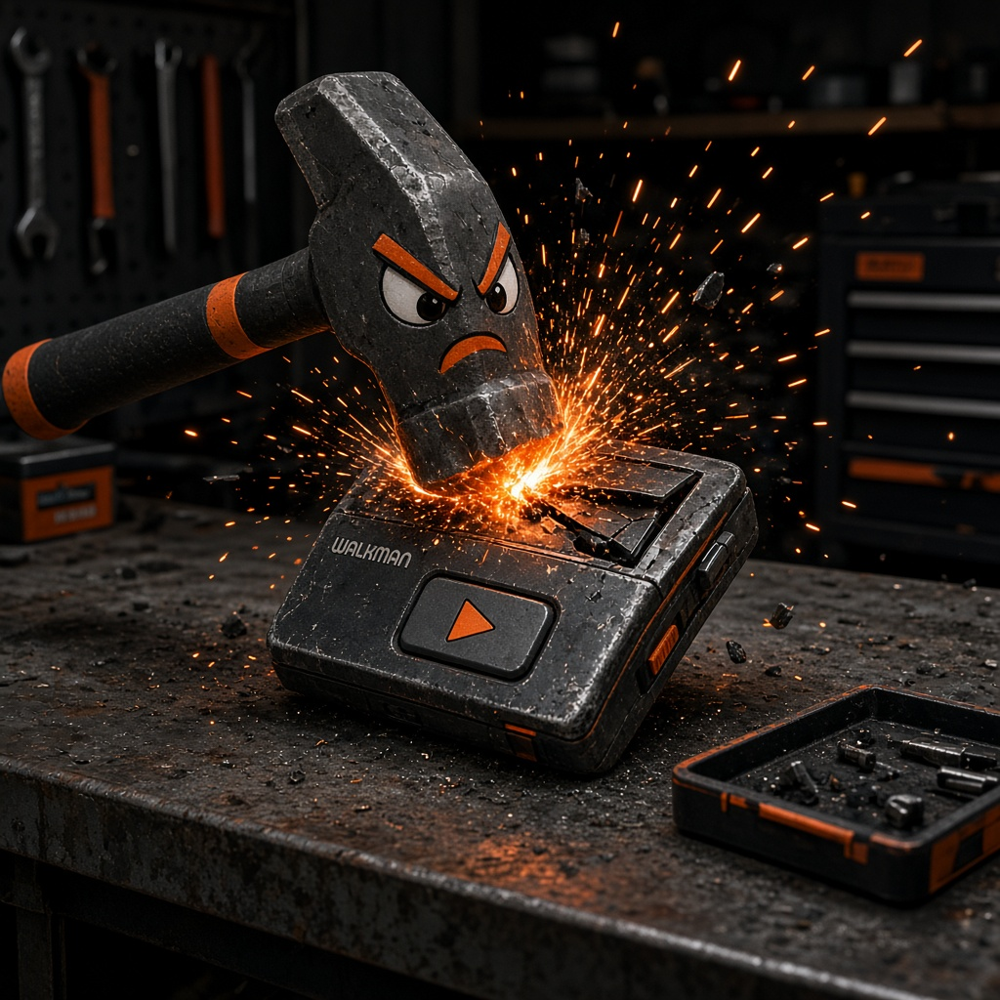
</p>

O progresso fica amarrado ao **personagem**, não só à conta. Conta → agente → intel e conquistas. Assim, cada pessoa na mesa tem o próprio dossiê.

---

## O painel do mestre

Sem entrar em botões: o operador da mesa usa LimboOS para…

| Frente | O que isso significa na sessão |
|:-------|:-------------------------------|
| **Ao vivo** | Acompanhar quem está na operação agora |
| **Mesa** | Esquadrões, vínculos, quem joga com quem |
| **Missões** | Montar e disparar o próximo batimento da história |
| **Conteúdo** | Criar e distribuir intel, mídia, SMS |
| **Sistema** | Relatórios e o rastro do que a operação deixou |

A ideia é manter o mestre no ritmo do RPG: soltar a pista no segundo em que o silêncio pede pista.

---

## Tom e imersão

LimboOS é ARG com carinho de mesa de RPG. Textos em português do Brasil. Interface que parece ter nascido entre 1984 e 2003. Laranja de alerta. Fontes que lembram manuais e displays. Pouca explicação “de produto”; muita presença de mundo.

Se algo parece estranho, incompleto ou um pouco quebrado — às vezes é proposital. A fenda também rachou a interface.

---

## O que LimboOS *não* é

- Não é um OS real.  
- Não substitui a mesa, o mestre nem os dados.  
- Não é um feed genérico de “conteúdo gamificado”.  
- Não é só um player de áudio com skin retrô.

É um **companion narrativo**: o objeto diegético que os personagens usam enquanto a história acontece.

---

<p align="center">
  
</p>

<p align="center">
  <strong>LimboOS é o aparelho que o seu agente não deveria ter —<br />e que a mesa precisa que ele tenha.</strong>
</p>

<p align="center">
  <em>Bem-vindo à fenda. Rebobine com cuidado.</em>
</p>
